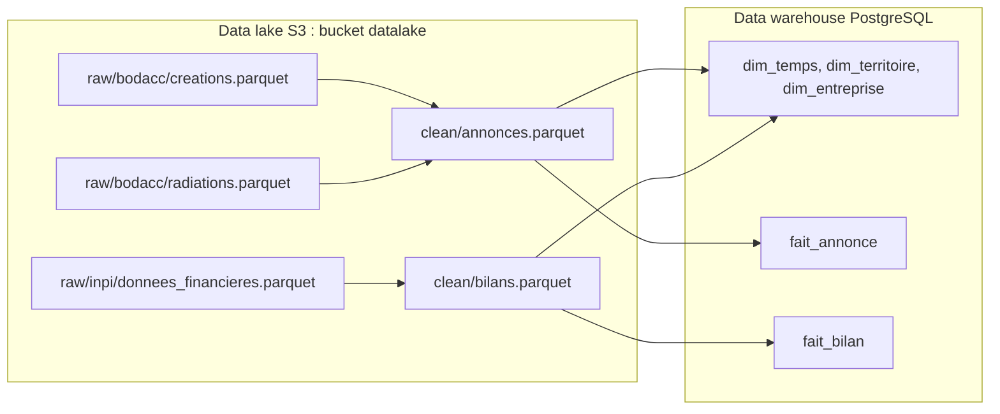
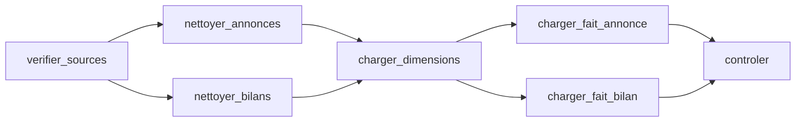
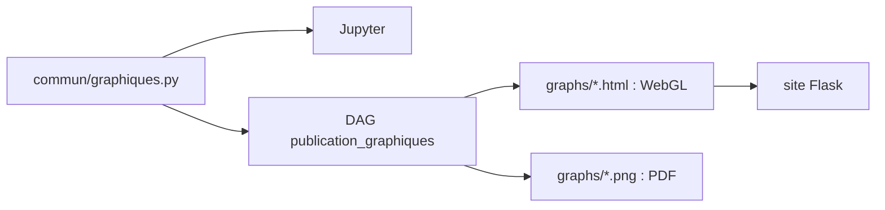
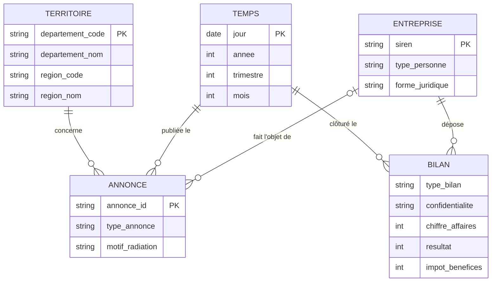
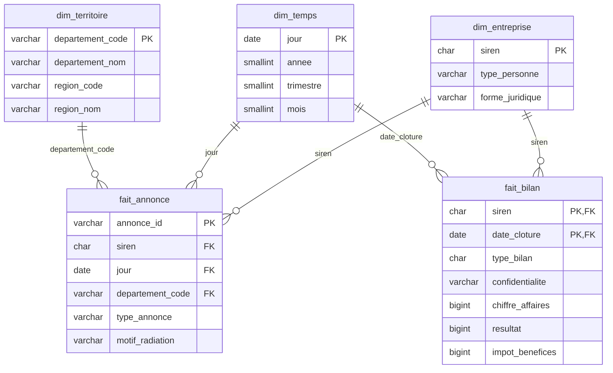

# Exercice 3 : data lake, Airflow et data warehouse en Docker

Un `docker compose up` monte toute la chaîne : les Parquet bruts sont déposés dans un bucket S3, un DAG Airflow les nettoie puis les charge dans un data warehouse PostgreSQL, un Jupyter permet d'explorer les deux, et un site web publie les graphiques validés dans Jupyter.

## Lancer

Prérequis : Docker, et les 3 fichiers dans `../data/` (non versionnés, 5,3 Go) :

| Fichier | Source |
|---|---|
| `bodacc creation.parquet` | [BODACC, annonces commerciales](https://www.bodacc.fr/explore/dataset/annonces-commerciales/), famille « Créations » |
| `bodacc radiations.parquet` | idem, famille « Radiations » |
| `données financières.parquet` | [Données financières détaillées des entreprises](https://www.data.gouv.fr/datasets/donnees-financieres-detaillees-des-entreprises-format-parquet) |

```bash
cd exercice-3
docker compose up -d --build
```

Au premier démarrage, `datalake-init` dépose les fichiers dans le bucket (environ 1 min). Ensuite, ouvrir Airflow sur http://localhost:8080, DAG `chargement_dw`, bouton **Trigger**. Ou en ligne de commande :

```bash
docker compose exec airflow airflow dags trigger chargement_dw
```

Le DAG prend environ 20 minutes (dont 15 pour insérer les 9,4 M annonces dans PostgreSQL). `docker compose down` arrête tout ; `docker compose down -v` efface aussi le bucket et la base.

| Service | Rôle | Accès |
|---|---|---|
| `datalake` | Data lake S3 ([RustFS](https://rustfs.com), compatible MinIO/AWS) | API `localhost:9000`, console http://localhost:9001 (`admin` / `admin12345`) |
| `datalake-init` | Crée le bucket `datalake` et y dépose les fichiers bruts, puis s'arrête | |
| `dw` | Data warehouse PostgreSQL (base `dw`) et métadonnées Airflow (base `airflow`) | `localhost:5433` (`dw` / `dw`) |
| `airflow` | Orchestration et visualisation des flux | http://localhost:8080 |
| `jupyter` | Prototypage Python (`notebooks/exploration.ipynb`) | http://localhost:8888 |
| `site` | Site Flask qui affiche les graphiques (voir plus bas) | http://localhost:5000 |

Les ports n'écoutent que sur `127.0.0.1` : les services, sans mot de passe pour Airflow et Jupyter, ne sont pas accessibles depuis le réseau.

Airflow et Jupyter partagent la même image (`Dockerfile`) : Airflow 3.3, DuckDB, JupyterLab, Plotly, Chromium (pour l'export PNG) et Quarto (pour le rapport PDF). DuckDB lit et écrit directement dans le bucket et dans PostgreSQL : pas de fichier intermédiaire en local.

MinIO a été remplacé par RustFS parce que les images MinIO ne sont plus publiées sur Docker Hub. Le protocole S3 est le même.

## Les flux



### DAG Airflow `chargement_dw`



| Tâche | Ce qu'elle fait |
|---|---|
| `verifier_sources` | Échoue si un des 3 fichiers bruts manque dans le bucket. |
| `nettoyer_annonces` | Fusionne créations et radiations, garde les avis initiaux, extrait le SIREN, le type de personne et la forme juridique, classe le motif de radiation. Écrit `clean/annonces.parquet`. |
| `nettoyer_bilans` | Garde les comptes sociaux, un bilan par SIREN et par exercice, extrait CA, résultat et impôt de la liasse fiscale. Écrit `clean/bilans.parquet`. |
| `charger_dimensions` | Vide le data warehouse puis charge les 3 dimensions. Le DAG peut donc être relancé sans doublons. |
| `charger_fait_annonce`, `charger_fait_bilan` | Chargent les faits, en parallèle. |
| `controler` | Échoue si une table est vide ; affiche le nombre de lignes et l'indicateur de l'exercice 1 (sociétés créées / radiées hors radiations d'office, par année). |

### Règles de nettoyage

| Règle | Pourquoi |
|---|---|
| Seuls les avis initiaux (`typeavis = annonce`) | Les annulations et rectificatifs compteraient deux fois la même annonce. |
| SIREN = 1ʳᵉ partie de `registre`, sans espaces, 9 chiffres | `registre` vaut `"449 850 908,449850908"` ou l'inverse selon l'annonce. |
| `type_personne` : `pm` (société) ou `pp` (entrepreneur individuel) | Seules les sociétés paient l'IS. |
| Motif de radiation : `office`, `liquidation`, `autre` | Les radiations d'office sont administratives et faussent le nombre de fermetures. |
| Bilans : comptes consolidés écartés, un bilan par SIREN et par exercice (complet prioritaire sur simplifié), clôture entre 2000 et 2030 | Ne pas compter deux fois la même entreprise ; écarter les dates aberrantes (1919, 2029…). |
| Liasse : `FL` / `HN` / `HK` (régime normal), `210+214+218` / `310` / `306` (simplifié) | Codes du chiffre d'affaires, du résultat et de l'impôt sur les bénéfices. |
| Résultat publié mais impôt absent → impôt = 0 | Une ligne vide de la liasse vaut zéro. |

## Graphiques sur le web

Les graphiques validés dans Jupyter sont publiés sur http://localhost:5000. Pour qu'ils soient strictement identiques, ils sont écrits **une seule fois**, dans `commun/graphiques.py` : une fonction par graphique, qui interroge le data warehouse et renvoie une figure Plotly. Le notebook l'appelle (`graphiques.creations_radiations(con)`), le DAG aussi.



Le DAG `publication_graphiques` se lance à la main, après `chargement_dw` (le déclenchement automatique est prêt, en commentaire, dans le DAG) :

```bash
docker compose exec airflow airflow dags trigger publication_graphiques
```

Il écrit deux versions de chaque graphique dans `graphs/` (non versionné) :

| Fichier | Tracés | Usage |
|---|---|---|
| `<nom>.html` | `Scattergl` : dessin par le GPU (WebGL), fluide même avec beaucoup de points | Site web ; plotly.js inclus, fonctionne sans internet |
| `<nom>.png` | `Scatter`, rendu par kaleido + Chromium | Rapport PDF |

Le site (`site/`) ne dépend que de Flask : il liste les HTML de `graphs/` et les affiche, sans accès à la base ni code de dataviz. Ajouter un graphique : une fonction dans `commun/graphiques.py`, inscrite dans `GRAPHIQUES`.

## Rapport PDF

Le DAG `rapport` (lancement manuel) produit `rapport/pdf/rapport.pdf` (non versionné) : le graphique et le tableau du notebook, sur une page.

```bash
docker compose exec airflow airflow dags trigger rapport
```

La source est `rapport/rapport.qmd`, un document [Quarto](https://quarto.org) : du Markdown avec des cellules Python exécutées au rendu. Elles appellent `commun/graphiques.py` exactement comme le notebook (`creations_radiations`, `is_par_tranche`), donc les chiffres et le graphique sont les mêmes. Le PDF est composé par [Typst](https://typst.app), inclus dans Quarto : pas de LaTeX à installer.

## Forme finale des données

**Deux étapes de stockage.** `raw/` garde les fichiers tels que téléchargés : on peut toujours tout recalculer. `clean/` contient les données nettoyées, au format du data warehouse, en Parquet : on les relit dans Jupyter sans toucher à la base, et le chargement ne refait pas le nettoyage.

**Un schéma en étoile dans le data warehouse.** Les questions de l'exercice 1 se posent toutes de la même façon : *combien* (annonces, impôt, chiffre d'affaires) *par* année, département, type d'entreprise. Les faits portent ce qu'on compte ou additionne, les dimensions ce par quoi on découpe :

- **deux faits**, parce qu'ils n'ont pas le même grain : une annonce est un événement daté, un bilan est un exercice comptable ;
- **trois dimensions partagées** : le SIREN relie annonces et bilans (survie, impôt des sociétés créées) ; la date et le département permettent de comparer avant et après une réforme, et territoire par territoire ;
- les noms des personnes ne sont pas repris : ils ne servent à aucun indicateur.

### MCD



### MLD

Créé au premier démarrage de PostgreSQL par `sql/01_dw.sql`.


