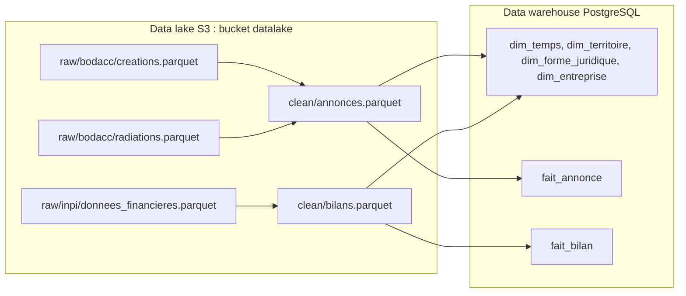
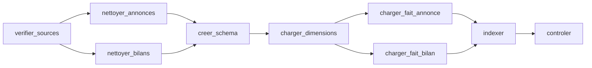
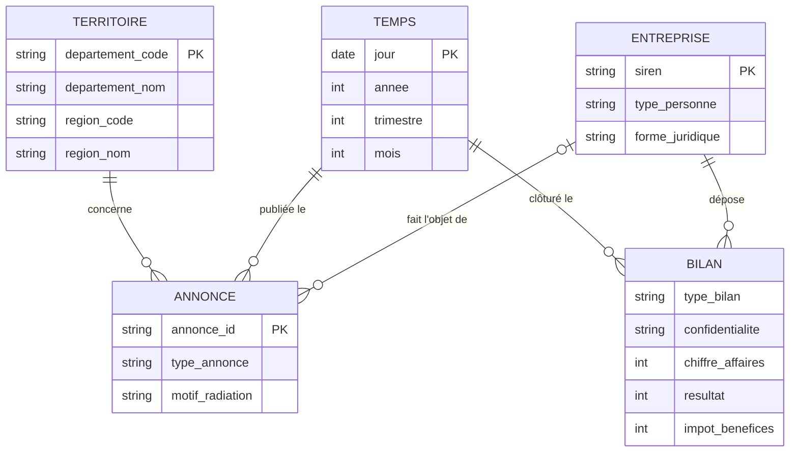
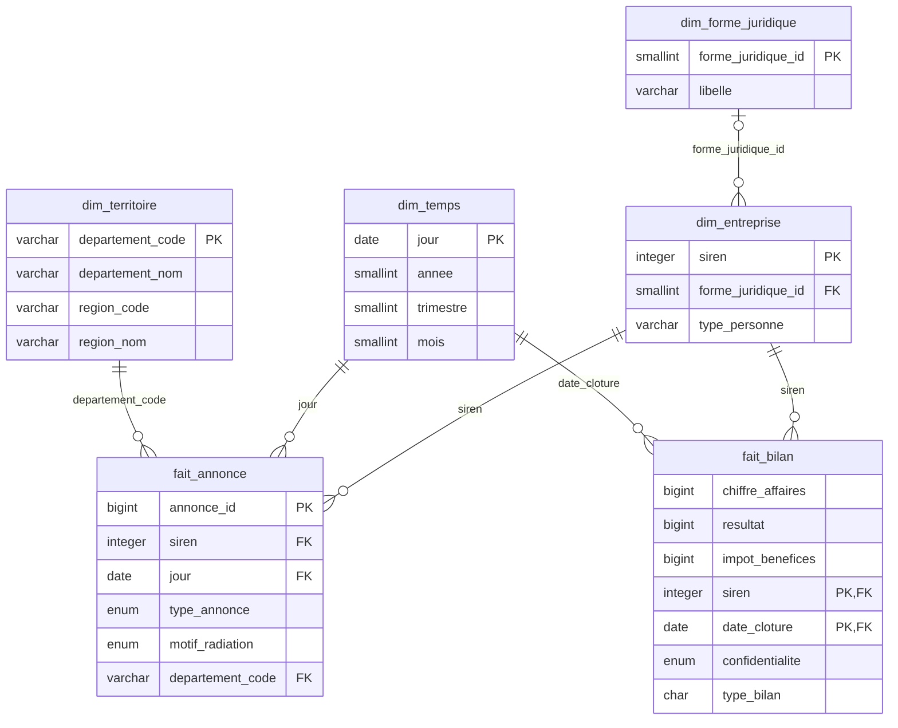
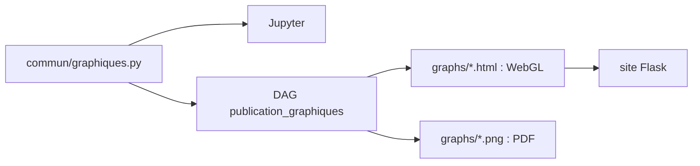

# Exercice 3 : data lake, Airflow et data warehouse en Docker

Un `docker compose up` monte toute la chaîne : les Parquet bruts sont déposés dans un bucket S3, un DAG Airflow les nettoie puis les charge dans un data warehouse PostgreSQL, un Jupyter permet d'explorer les deux, un site web publie les graphiques validés dans Jupyter et un DAG produit un rapport PDF.

## Accès en local

| Service | URL | Identifiants |
|---|---|---|
| Airflow | http://localhost:8080 | aucun |
| Jupyter | http://localhost:8888 | aucun |
| Site des graphiques | http://localhost:5000 | aucun |
| Data lake (console RustFS) | http://localhost:9001 | `admin` / `admin12345` |
| Data lake (API S3) | http://localhost:9000 | `admin` / `admin12345` |
| Data warehouse PostgreSQL | `localhost:5433`, base `dw` | `dw` / `dw` |

Les ports n'écoutent que sur `127.0.0.1` : les services, sans mot de passe pour Airflow et Jupyter, ne sont pas accessibles depuis le réseau.

## Lancer

Prérequis : Docker, et les 3 fichiers dans `../data/` (non versionnés, environ 5,7 Go ; voir [`data/README.md`](../data/README.md), le script `telecharger_bodacc.py` télécharge les deux fichiers BODACC sans qu'ils soient tronqués) :

| Fichier | Source |
|---|---|
| `bodacc creation.parquet` | [BODACC, annonces commerciales](https://www.bodacc.fr/explore/dataset/annonces-commerciales/), famille « Créations » |
| `bodacc radiations.parquet` | idem, famille « Radiations » |
| `données financières.parquet` | [Données financières détaillées des entreprises](https://www.data.gouv.fr/datasets/donnees-financieres-detaillees-des-entreprises-format-parquet) |

```bash
cd exercice-3
docker compose up -d --build
docker compose exec airflow airflow dags trigger chargement_dw   # ou bouton Trigger dans Airflow
```

Au premier démarrage, `datalake-init` dépose les fichiers dans le bucket (environ 1 min). Le DAG `chargement_dw` prend ensuite environ 1 minute pour 10,9 M annonces et 6,3 M bilans. `docker compose down` arrête tout ; `docker compose down -v` efface aussi le bucket et la base.

| DAG | Consigne | Lancement |
|---|---|---|
| `chargement_dw` | 1. Data lake → data warehouse | manuel |
| `publication_graphiques` | 2. Graphiques sur le web | manuel, après `chargement_dw` |
| `rapport` | 3. Rapport PDF | manuel, après `chargement_dw` |
| `mesures` | 4. Optimisation de la base | manuel, ne modifie rien |

| Service | Rôle |
|---|---|
| `datalake` | Data lake S3 ([RustFS](https://rustfs.com), compatible MinIO/AWS) |
| `datalake-init` | Crée le bucket `datalake` et y dépose les fichiers bruts, puis s'arrête |
| `dw` | Data warehouse PostgreSQL (base `dw`) et métadonnées Airflow (base `airflow`) |
| `airflow` | Orchestration et visualisation des flux |
| `jupyter` | Prototypage Python (`notebooks/exploration.ipynb`) |
| `site` | Site Flask qui affiche les graphiques (consigne 2) |

Airflow et Jupyter partagent la même image (`Dockerfile`) : Airflow 3.3, DuckDB, JupyterLab, Plotly, Chromium (pour l'export PNG) et Quarto (pour le rapport PDF). DuckDB lit et écrit directement dans le bucket et dans PostgreSQL : pas de fichier intermédiaire en local.

MinIO a été remplacé par RustFS parce que les images MinIO ne sont plus publiées sur Docker Hub. Le protocole S3 est le même.

---

## Consigne 1 : data lake, traitements, Jupyter et Airflow en Docker

> Le gouvernement veut une instance Docker : un data lake sous forme de bucket S3 qui contient les jeux de données bruts ; les traitements de données de la présentation de l'exercice précédent ; un environnement de prototypage Jupyter Notebook ; un Apache Airflow pour l'orchestration et la visualisation ; une documentation des flux appliqués aux jeux de données, dans le README, avec un schéma d'Airflow. Justifier la forme finale des données. L'étape finale est l'insertion dans le data warehouse : fournir le MCD/MLD.

### Les flux



#### DAG Airflow `chargement_dw`



| Tâche | Ce qu'elle fait |
|---|---|
| `verifier_sources` | Échoue si un des 3 fichiers bruts manque dans le bucket. |
| `nettoyer_annonces` | Fusionne créations et radiations, garde les avis initiaux, extrait le SIREN, le type de personne et la forme juridique, classe le motif de radiation. Écrit `clean/annonces.parquet`. |
| `nettoyer_bilans` | Garde les comptes sociaux, un bilan par SIREN et par exercice, extrait CA, résultat et impôt de la liasse fiscale. Écrit `clean/bilans.parquet`. |
| `creer_schema` | Recrée les tables vides et sans index (`sql/01_dw.sql`). Le DAG peut donc être relancé sans doublons. |
| `charger_dimensions` | Charge les 4 dimensions. |
| `charger_fait_annonce`, `charger_fait_bilan` | Chargent les faits, en parallèle, triés par date. |
| `indexer` | Crée clés primaires, clés étrangères et index en une fois (`sql/02_index.sql`), puis `VACUUM ANALYZE`. |
| `controler` | Échoue si une table est vide ; affiche le nombre de lignes et l'indicateur de l'exercice 1 (sociétés créées / radiées hors radiations d'office, par année). |

#### Règles de nettoyage

| Règle | Pourquoi |
|---|---|
| Seuls les avis initiaux (`typeavis = annonce`) | Les annulations et rectificatifs compteraient deux fois la même annonce. |
| SIREN = 1ʳᵉ partie de `registre`, sans espaces, 9 chiffres | `registre` vaut `"449 850 908,449850908"` ou l'inverse selon l'annonce. |
| `type_personne` : `pm` (société) ou `pp` (entrepreneur individuel) | Seules les sociétés paient l'IS. |
| Motif de radiation : `office`, `liquidation`, `autre` | Les radiations d'office sont administratives et faussent le nombre de fermetures. |
| Bilans : comptes consolidés écartés, un bilan par SIREN et par exercice (complet prioritaire sur simplifié), clôture entre 2000 et 2030 | Ne pas compter deux fois la même entreprise ; écarter les dates aberrantes (1919, 2029…). |
| Liasse : `FL` / `HN` / `HK` (régime normal), `210+214+218` / `310` / `306` (simplifié) | Codes du chiffre d'affaires, du résultat et de l'impôt sur les bénéfices. |
| Résultat publié mais impôt absent → impôt = 0 | Une ligne vide de la liasse vaut zéro. |

### Forme finale des données

**Deux étapes de stockage.** `raw/` garde les fichiers tels que téléchargés : on peut toujours tout recalculer. `clean/` contient les données nettoyées, au format du data warehouse, en Parquet : on les relit dans Jupyter sans toucher à la base, et le chargement ne refait pas le nettoyage.

**Un schéma en étoile dans le data warehouse.** Les questions de l'exercice 1 se posent toutes de la même façon : *combien* (annonces, impôt, chiffre d'affaires) *par* année, département, type d'entreprise. Les faits portent ce qu'on compte ou additionne, les dimensions ce par quoi on découpe :

- **deux faits**, parce qu'ils n'ont pas le même grain : une annonce est un événement daté, un bilan est un exercice comptable ;
- **trois dimensions partagées**, plus `dim_forme_juridique` qui évite de répéter ~1 800 libellés sur 9 M d'entreprises : le SIREN relie annonces et bilans (survie, impôt des sociétés créées) ; la date et le département permettent de comparer avant et après une réforme, et territoire par territoire ;
- les noms des personnes ne sont pas repris : ils ne servent à aucun indicateur.

#### MCD



#### MLD

Tables : `sql/01_dw.sql` ; clés et index : `sql/02_index.sql`. Les deux sont exécutés au premier démarrage de PostgreSQL, puis par `chargement_dw`.



---

## Consigne 2 : pérenniser les graphiques de Jupyter dans une interface web

> Admettons que vos graphes du Jupyter soient validés. Le client souhaite les pérenniser dans une interface web. Les graphes doivent être strictement identiques, venir du même code que celui de Jupyter. Utiliser un microframework web moderne, un minimum de dépendances front/back/dataviz. Dépendance conseillée : Plotly, qui permet de générer du HTML et un graphe avec WebGL, mais également des images pour le PDF.

Les graphiques validés dans Jupyter sont publiés sur http://localhost:5000. Pour qu'ils soient strictement identiques, ils sont écrits **une seule fois**, dans `commun/graphiques.py` : une fonction par graphique, qui interroge le data warehouse et renvoie une figure Plotly. Le notebook l'appelle (`graphiques.creations_radiations(con)`), le DAG aussi.



Le DAG `publication_graphiques` se lance à la main, après `chargement_dw` (le déclenchement automatique est prêt, en commentaire, dans le DAG) :

```bash
docker compose exec airflow airflow dags trigger publication_graphiques
```

Il écrit deux versions de chaque graphique dans `graphs/` (non versionné) :

| Fichier | Tracés | Usage |
|---|---|---|
| `<nom>.html` | `Scattergl` : dessin par le GPU (WebGL), fluide même avec beaucoup de points | Site web ; plotly.js inclus, fonctionne sans internet |
| `<nom>.png` | `Scatter`, rendu par kaleido + Chromium | Rapport PDF |

Le site (`site/`) ne dépend que de Flask : il liste les HTML de `graphs/` et les affiche, sans accès à la base ni code de dataviz. Ajouter un graphique : une fonction dans `commun/graphiques.py`, inscrite dans `GRAPHIQUES`.

---

## Consigne 3 : rapport PDF avec un framework moderne

> Un nouveau DAG qui produit un rapport avec les données et les graphiques du notebook Jupyter, avec un framework moderne.

Le DAG `rapport` (lancement manuel) produit `rapport/pdf/rapport.pdf` (non versionné) : le graphique et le tableau du notebook, sur une page.

```bash
docker compose exec airflow airflow dags trigger rapport
```

La source est `rapport/rapport.qmd`, un document [Quarto](https://quarto.org) : du Markdown avec des cellules Python exécutées au rendu. Elles appellent `commun/graphiques.py` exactement comme le notebook (`creations_radiations`, `is_par_tranche`), donc les chiffres et le graphique sont les mêmes. Le PDF est composé par [Typst](https://typst.app), inclus dans Quarto : pas de LaTeX à installer.

---

## Consigne 4 : optimisation de la base

> Expliquer comment optimiser une base de données (volume, temps des requêtes). Dans le GitHub, faire un commit pour l'optimisation. Que l'évolution soit facile à évaluer.

L'évolution se lit dans deux commits : *Mesures de référence de la base* (état avant, `mesures/avant/`) puis *Optimisation de la base* (changements et état après, `mesures/apres/`). Le diff du second montre exactement ce qui a changé dans le schéma (`sql/`), le chargement et la configuration.

### Mesurer

Le DAG `mesures` (lancement manuel, ne modifie rien) mesure le data warehouse et écrit le résultat dans `mesures/<etiquette>/` (versionné) :

- **volume** : lignes, taille des données et des index, octets par ligne, pour chaque table ;
- **temps des requêtes** : médiane de 5 exécutions (cache chaud) des requêtes du notebook, du rapport et de `controler`, plus un accès par période et un accès par SIREN ; plans d'exécution dans `plans/` ;
- **durée du chargement** : temps de chaque tâche du dernier `chargement_dw` réussi, lu dans les métadonnées d'Airflow.

```bash
docker compose exec airflow airflow dags trigger mesures                              # -> mesures/avant/
docker compose exec airflow airflow dags trigger mesures -c '{"etiquette": "apres"}'  # -> mesures/apres/
```

Même méthode avant et après une optimisation : comparer `mesures/avant/resultats.md` et `mesures/apres/resultats.md`.

### Optimiser

Mesures complètes : [`mesures/avant/`](mesures/avant/resultats.md) et [`mesures/apres/`](mesures/apres/resultats.md), même DAG, mêmes requêtes, mêmes données (10,9 M annonces, 6,3 M bilans, 9,2 M entreprises).

| | Avant | Après | Gain |
|---|--:|--:|--:|
| Taille de la base | 3 356 Mo | 2 110 Mo | **−37 %** |
| dont index | 1 517 Mo | 787 Mo | **−48 %** |
| `fait_annonce` (octets / ligne, index compris) | 158 | 99 | −37 % |
| Requête annuelle du notebook (`creations_radiations`) | 2 961 ms | 1 727 ms | **−42 %** |
| Indicateur de `controler` | 3 185 ms | 1 759 ms | −45 % |
| IS par tranche de CA, 2023 | 375 ms | 277 ms | −26 % |
| Créations par département, 1 trimestre | 30,7 ms | 23,9 ms | −22 % |
| Chargement complet (`chargement_dw`) | 436 s | 62 s | **÷ 7** |
| dont insertion de `fait_annonce` | 349 s | 8 s | ÷ 44 |

**Volume : des types plus compacts** (`sql/01_dw.sql`). Chaque octet gagné l'est sur des millions de lignes, et aussi dans chaque index qui contient la colonne.

- `siren` : `CHAR(9)` → `INTEGER` (10 → 4 octets), dans 3 tables et 3 index. Les zéros de tête se restituent avec `lpad(siren::text, 9, '0')`.
- `annonce_id` : `VARCHAR` → `BIGINT`, la lettre devenant un chiffre (`A2008000110` → `12008000110`) : la clé primaire passe de 429 à 234 Mo.
- Valeurs fermées en `ENUM` (4 octets au lieu du texte) : `type_annonce`, `motif_radiation`, `confidentialite` ; `type_bilan` en `"char"` (1 octet).
- `forme_juridique` sortie dans `dim_forme_juridique` : ~1 800 libellés stockés une fois, une clé `SMALLINT` dans `dim_entreprise` (107 → 64 octets par ligne).
- Colonnes de 8 octets en tête de ligne : PostgreSQL aligne les valeurs, un `BIGINT` après un `DATE` laisserait 4 octets vides.

**Index : moins nombreux, mieux choisis** (`sql/02_index.sql`).

- Les faits sont insérés **triés par date** (corrélation date / position sur disque : 0,53 → 1). Un index **BRIN**, qui ne garde que le min et le max de chaque bloc de pages, suffit alors pour les filtres sur une période : 85 Mo → 0,02 Mo pour `jour`, 42 Mo → 0,02 Mo pour `date_cloture`.
- Le B-tree sur `fait_annonce.siren` est gardé : il sert l'accès à l'historique d'une entreprise (0,04 ms).

**Chargement : index et contraintes après l'insertion** (`chargement_dw`). Mettre à jour 4 index et 3 clés étrangères à chaque ligne insérée coûtait 80 % du temps. Le DAG recrée maintenant les tables nues (`creer_schema`), insère, puis construit clés et index en une fois (`indexer`, 27 s). Il finit par `VACUUM ANALYZE` : statistiques à jour pour le planificateur et carte de visibilité pour les lectures d'index seul.

**Configuration de PostgreSQL** (`docker-compose.yml`). Avant, réglages par défaut : 128 Mo de cache (`shared_buffers`), 4 Mo par jointure (`work_mem`). Les plans montraient alors 1,2 Go relus hors du cache et 580 Mo de fichiers temporaires pour la jointure avec `dim_entreprise`. Avec 2 Go de cache, 128 Mo par jointure et 4 workers parallèles, tout est servi depuis la mémoire, sans fichier temporaire (voir `plans/`).

